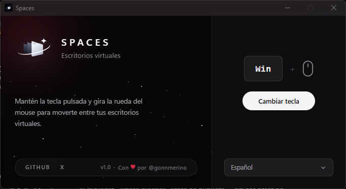

# Spaces

Switch between virtual desktops on Windows with a key + mouse wheel.

Hold the key, scroll, and move between desktops. That's it.



## Features

- Any key as trigger: Win, Alt, Shift, Caps Lock, or F1–F12
- 12 languages
- Starts with Windows, sits in the tray
- Your settings are remembered

## Download

Get the installer from [Releases](../../releases) and run it.

> Windows SmartScreen may warn since the app isn't signed. Click _More info → Run anyway_.

## Build from source

```bash
bun install
bun run tauri dev     # development
bun run tauri build   # installer → src-tauri/target/release/bundle/nsis/
```

Requires [Bun](https://bun.sh) and [Rust](https://rust-lang.org).

## License

[MIT](LICENSE) — © gonnmerino
